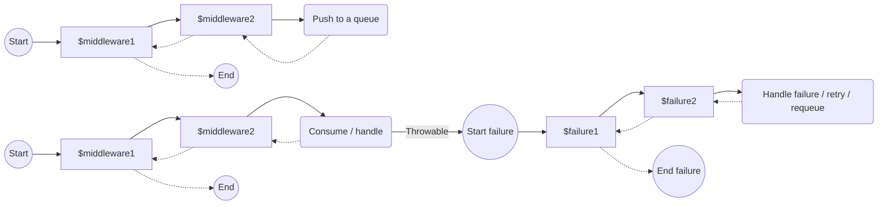

# Middleware pipelines

Yii Queue uses middlewares to run custom logic around message pushing and message processing.

A middleware is a piece of code that receives a request object and can either:

- change the request (for example, change the message, adapter, or error handling behavior) and continue the pipeline, or
- stop the pipeline by returning without calling the next handler.

The pipeline mechanism is similar to HTTP middleware, but applied to queue messages.

## What middlewares are for

Common reasons to add middlewares:

- **Collect metrics**
  You can count pushed/processed messages, measure handler duration, or measure time between push and consume.
- **Add tracing / correlation data**
  You can put trace ids or correlation ids into message metadata so logs from producer/consumer are connected.
- **Logging and observability**
  You can log message ids, queue names, attempts, and failures in a consistent way.
- **Modify the message payload**
  You can obfuscate sensitive data, normalize payload, add extra fields required by consumers, or wrap a message into envelopes.
- **Route and schedule**
  You can switch queue, choose a different adapter, or add delay when the adapter supports it.

## Pipelines overview

Each message may pass through three independent pipelines:

- **Push pipeline** (executed when calling `QueueProducerInterface::push()`).
- **Consume pipeline** (executed when a worker processes a message).
- **Failure handling pipeline** (executed when message processing throws a `Throwable`).

The execution order inside a pipeline is forward in the same order you configured middlewares.



## How to define a middleware

You can use any of these formats:

- A ready-to-use middleware object.
- An array in the format of [yiisoft/definitions](https://github.com/yiisoft/definitions), which defines a middleware implementation.
- A string for your DI container to resolve the middleware, e.g. `FooMiddleware::class`.
- An [extended callable definition](callable-definitions-extended.md). A callable should either be a middleware itself or return a configured middleware object.

> **Note:** The formats above are supported by the default `PushMiddlewareFactory`. When using a custom
> `PushMiddlewareFactoryInterface` implementation, it may accept additional definition formats.

The required interface depends on the pipeline:

- Push: `Yiisoft\Queue\Middleware\Push\PushMiddlewareInterface`
- Consume: `Yiisoft\Queue\Middleware\Consume\ConsumeMiddlewareInterface`
- Failure handling: `Yiisoft\Queue\Middleware\FailureHandling\FailureMiddlewareInterface`

## Push pipeline

The push pipeline is executed when calling `QueueProducerInterface::push()`.

Push middlewares receive the message and return a message, so they can wrap it into envelopes, add metadata,
obfuscate data, and so on.

The adapter is not part of the pipeline: it is fixed when the producer is built, and the push pipeline ends with a
final handler that pushes through it (`AdapterPushHandler` for `AsyncQueueProducer`, `SynchronousPushHandler` for
`SyncQueueProducer`). To route messages to different backends, resolve a different producer by queue name through
`QueueProducerProviderInterface` instead — see [Queue names](queue-names.md).

### Custom push middleware

Implement `PushMiddlewareInterface` and return the message to pass down the pipeline:

```php
public function processPush(MessageInterface $message, PushHandlerInterface $handler): MessageInterface
{
    return $handler->handlePush(new MyEnvelope($message));
}
```

## Consume pipeline

The consume pipeline is executed by the worker while processing a message.

Consume middlewares are often used to modify the message and/or collect runtime information:

- Measure handler execution time.
- Add correlation ids and include them into logs.
- Convert thrown exceptions into domain-specific failures.

The final handler of the consume pipeline invokes the resolved message handler.

## Failure handling pipeline

When a `Throwable` escapes the consume pipeline, the worker switches to the failure handling pipeline.

The pipeline receives a `FailureHandlingRequest` that contains:

- the message
- the caught exception
- the queue instance

The pipeline is selected by queue name; if there is no queue-specific pipeline configured,
`FailureMiddlewareDispatcher::DEFAULT_PIPELINE` is used.

See [Error handling on message processing](error-handling.md) for the step-by-step flow and built-in middlewares.

## Configuration

### With yiisoft/config

When using [yiisoft/config](https://github.com/yiisoft/config), pipelines are configured in params under `yiisoft/queue`:

- `middlewares-push`
- `middlewares-consume`
- `middlewares-fail`

See [Configuration with yiisoft/config](configuration-with-config.md) for examples.

### Manual configuration (without yiisoft/config)

When configuring the component manually, you instantiate the middleware dispatchers and pass them to `SyncQueueProducer` / `AsyncQueueProducer`, `QueueConsumer`, and `Worker` as appropriate.

See [Manual configuration](configuration-manual.md) for a full runnable example.
